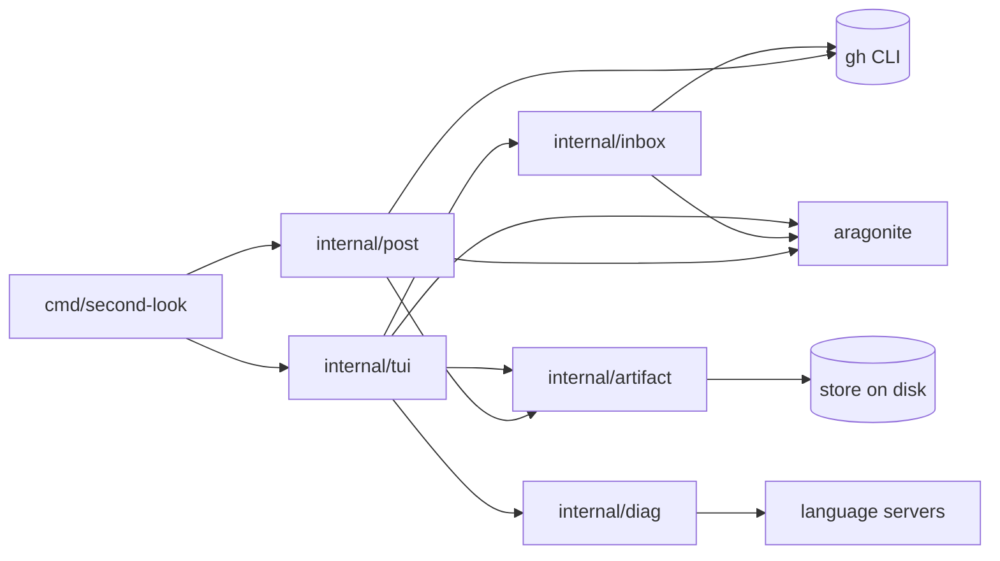

# Design

This file explains why second-look is shaped the way it is and how the pieces fit together. What to build next is in [ROADMAP.md](ROADMAP.md). I left the screens and keys out because the footer and `?` already describe them, and they change faster than this file does.

## The problem

Most of the code I ship is now written by an agent and reviewed first by a bot. An agent opens a pull request, a review bot reviews it, another agent drafts replies, and a third pushes fixes. Every step in that loop is automated except the one that matters most, which is a person reading the diff and deciding whether the change is right. On github.com that read is shallow, because the viewed checkbox is per file and resets on every push, a moved function shows up as a delete and an unrelated insert, and files arrive in alphabetical order. I ended up skimming, and the review I posted said LGTM whether or not I had really looked.

Two smaller problems sit under that one. Working through the queue of waiting pull requests meant opening a browser tab per repository, each with its own conventions. The comments I staged with an agent also lived in a markdown file with no schema, so nothing checked that a comment still pointed at the line it cited, and posting meant a series of `gh` calls that I had to supervise.

second-look puts the diff, the open threads, and my staged comments on one screen, remembers what I have read, and posts the review in a single call. It is also the interface the agents use, so the person and the bots work on the same artifact.

## Who it is for

It is for one person (me) reviewing many pull requests a day across many repositories, where the authors are often agents, and I have published it in case anyone else has the same loop. It assumes `gh` is signed in and that an agent such as Claude Code drafts comments through the skill the binary prints. It does not try to serve a team, a web UI, or any forge other than GitHub.

## Decisions

### The review is a local artifact

A review lives in a TOML file per pull request, written by the tool and by agents through the CLI, and nothing reaches GitHub until I press `S`. The alternative was to post comments as they are written, which is how `gh pr review` works. That loses the property I care about most, which is that a comment an agent drafted at 2am can be read, edited, and deleted before anyone else sees it.

TOML is the on-disk format because a person edits it. The agent and `gh` speak JSON, so JSON is the input and output of the CLI and is never something a person edits. Every field is either posted or local, and the payload builder reads only the posted fields. Local fields carry the command that proved a finding, the doubt, and the reason a finding was declined, so a private note cannot leak because someone forgot to remove it. An unknown field is refused, because a misspelled key is a hand edit that will not do what its author meant.

The store is one directory per repository under the user config directory, keyed by host, owner, and name, and a checkout that held reviews keeps a pointer to it. My first version kept the review in the checkout, and that turned `kyleking/second-look#2` read from two clones into two unrelated reviews.

### Posting is one call

`S` sends the review body and every line comment to GitHub's reviews endpoint in one request, so a failure leaves none of them posted. Replies to existing threads cannot ride in a review, so they follow as one request each. Before anything is sent, each comment's anchor is checked against the live diff and the pull request's head is compared with the one the review was written against. A comment that no longer anchors, or a head that moved, stops the post and says which. A draft present at submit time blocks the post instead of being posted or dropped. The artifact is deleted once GitHub has the review, and GitHub is the source of truth from then on.

### Seen-state is a content hash

A hunk is identified by its file plus every line of the hunk with the line numbers left out. A hunk that slides down the file stays read, and a hunk whose text changed comes back unread, so a force-push keeps the reading that still applies. I first planned to delegate this to `git range-diff`, and I built it and measured it. It answers nothing the hash does not, because it reports per commit and calls a pair identical only when the patch matches byte for byte, which is exactly when the hunk hashes match too.

### The queue is ordered in lanes

A flat list of pull requests says nothing about what to do next, so the queue has five lanes, drawn in this order: yours that are ready to merge, anything back in your court, new requests, pull requests waiting on others, and merged. The order keeps the work in flight small by finishing things before starting new ones. Inside a lane, drafts sink to the bottom. Above them a review already started comes first, then a priority label, then a request where I am the only human asked, then one in the area of the pull request I opened last, and then the oldest. The cost rating and the line count order nothing. They are drawn beside the row for me to weigh, because a rating that decides is a rating I would stop checking.

### Verdicts are reply states

Judging a bot finding is the most common action, so it gets one key. The verdict is the state of the staged reply to that finding's thread, and there are four. Discuss posts a reply and leaves the thread open. Todo posts a reply and sends the finding to a fixer. Won't fix posts a reply and then resolves the thread. Skip posts nothing. A blank reply is drafted by the agent to fit the verdict. Keeping the verdict and the reply as one object means there is no second list to drift out of step with the first.

On submit, todo replies go to a local agent run over ACP, or to nobody. A bot that fixes on a label or a mention is reached with the general keys: `l` sets a label from the repository's own list, and `@` completes a login. When the fixer pushes, the pull request returns to the back-to-you lane, and `H` shows which todos the new commits answered.

### Reviewing needs no checkout

The diff comes from the API, and a threaded reply carries a comment id instead of a line, so reading, judging, answering, and posting need no working tree. A checkout is something the reader asks for when they want to read around the change or run it. `C` moves a clone that is already on the laptop and never makes one, because a tool that cloned gigabytes to answer a keystroke would be the wrong tool. When several clones exist, they are ranked by what using one costs: already on the head, then clean, then one that needs a stash. gh-repo-dashboard already scans the clones, so second-look asks it instead of growing a second directory scanner. A lease file names the process holding a clone, so two sessions do not move one tree out from under each other.

### Chroma, ast-grep, and no cgo

The release builds every platform with `CGO_ENABLED=0`, and every tree-sitter binding for Go needs cgo. So highlighting uses [chroma](https://github.com/alecthomas/chroma), and the structural pass shells out to `ast-grep` when it is on the path. The tool already shells out to `gh`, `git`, `$EDITOR`, and `$SHELL`, and a missing binary costs one feature, which the screen says is off. I measured difftastic and ruled it out, because it calls a reworded comment a change and a pure reformat none, and telling comment changes from code changes is the distinction this pass exists to make.

### The language-server pass

Go to definition, references, the call graph, and checker notes come from whatever language server is installed, so second-look carries no index of its own yet. A file is opened as an unsaved buffer holding the commit under review, so nothing writes to the working tree. The server starts in the project the file belongs to instead of at the checkout root, because a TypeScript server rooted at a monorepo reads a package's imports as unresolvable and reports errors the change did not cause. A configured server that is not installed disables its extensions, since silently running a different server than the one named is worse. The cost is that nothing answers without a checkout, which is why these features run only when asked for and never to open a screen.

### The conversation queue

GitHub notifications fire on everything and say nothing about whose turn it is. The conversations tab lists the open discussions across every pull request I am in, bucketed by whose turn it is. A bot reaches it only through an inline review thread, because that is the one place its words anchor to code and can be resolved. Its pull request comments are coverage tables and nudges that nobody resolves, and without this rule the queue held 77 rows of which 13 were real. A machine account is told apart by GitHub's `__typename`, since a list of logins goes stale and `coderabbitai` carries no `[bot]` suffix.

## Architecture

| Package | Responsibility |
| --- | --- |
| `cmd/second-look` | Flags, target resolution, and the CLI an agent drives (`--help` is its contract) |
| `internal/tui` | The tabbed screen: queues, review, outline, tour, and the agent pane |
| `internal/inbox` | The review searches, lanes, and the order inside a lane |
| `internal/artifact` | The prepared review: schema, anchors, the store, and the caches keyed by head |
| `internal/post` | The anchor guard and the single review request |
| `internal/diag` | Language-server and `[[check]]` notes, placed against the diff |
| `aragonite` | Shared Go layer: `forge`, `vcs`, `cache`, `filter`, and `tui/` widgets |

About forty smaller packages sit under `internal/`, each with one job described in its package comment. `internal/get` prepares a review, `internal/plan` and `internal/order` decide the reading order, `internal/conversations` is the second queue, and `internal/acp` speaks to a local agent.

State lives under the user config directory, one directory per host, owner, and name, because the queue spans repositories and a review filed into whichever clone was open would be lost to every other one. A checkout that held reviews gets them moved there and a `WHERE.md` left behind. `second-look local` is the exception and keeps `local.toml` in the checkout. The diff, threads, and rating are cached by head commit and cleared when the review posts or is discarded, and `second-look gc` drops reviews for merged or closed pull requests and sweeps the caches.

Opening a staged review reads those files and makes one network call, which checks that the head still stands. The first frame waits for that check, because a diff staged against an older head has already been read by the time the screen admits it. Being offline costs that one round trip and leaves the review intact.

### Shared code

aragonite holds what gh-repo-dashboard and second-look both need: the GitHub client, git and jj behind one interface, a TTL cache with a disk layer, the filter engine, and the table and pane widgets. The two tools keep separate inboxes because they answer different questions. gh-repo-dashboard asks what state my repositories are in, and second-look asks what review I owe. `go.mod` pins a released aragonite version, and `mise run verify-released` builds and tests with `GOWORK=off` to prove the consumer works against the published version and not a sibling checkout.

## What it does not do

- Call a language model. Drafting is an agent's job, driven through the CLI and the skill, so no API key or prompt lives in this tool
- Run a daemon. The process starts fast and reads `.second-look/` and the cache, so there is no resident index to go stale
- Clone a repository, or move a working tree without asking
- Post to a forge other than GitHub. The forge layer is an interface so another could be added, and none has been
- Rate a pull request to decide anything, because the rating is advisory
- Attach an image to an inline review comment. `gh --attach` covers pull request comments only, and the endpoint it uses for reviews is undocumented
