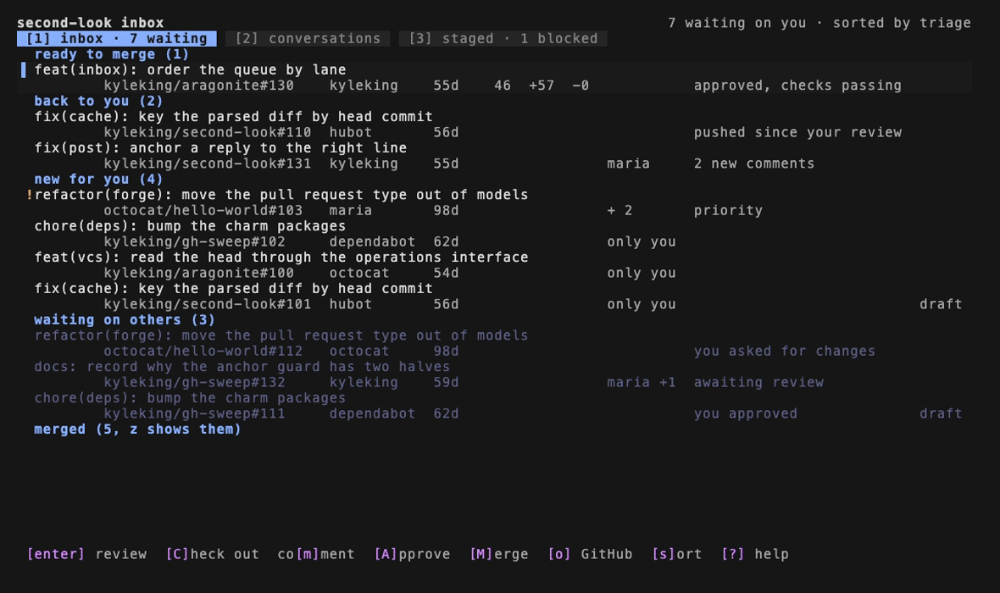
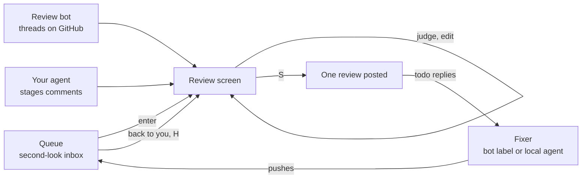
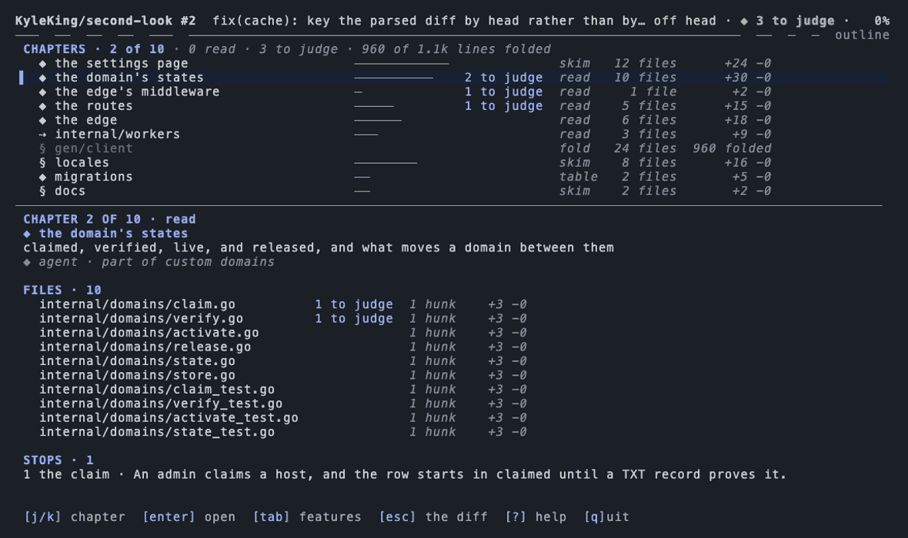
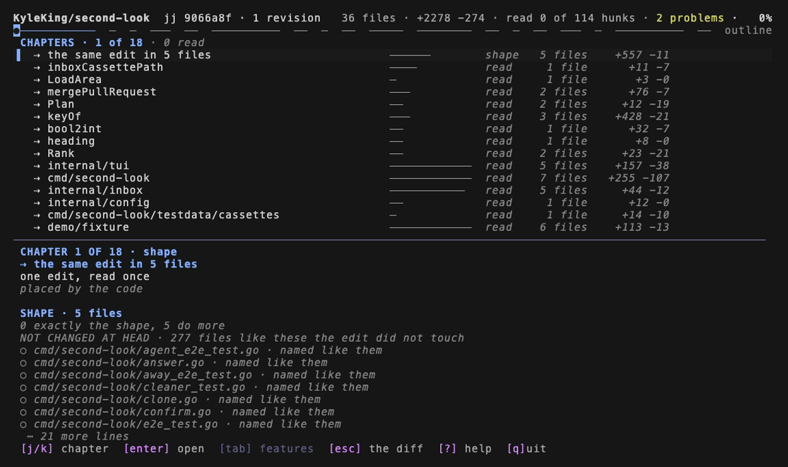
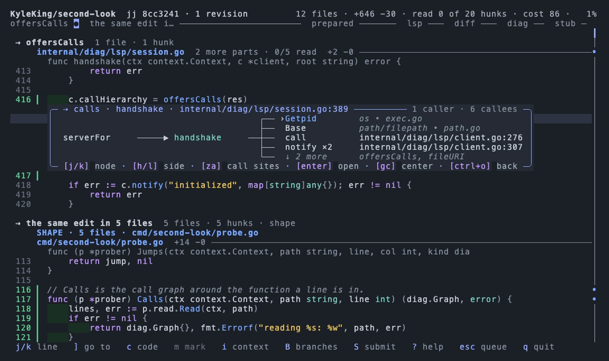

# second-look

A terminal code review tool optimized for the modern rate of code generation, is local-first and AI-friendly, and encourages us to actually read and understand the code as everything else changes. While this is currently personalized for my own use cases and workflows, it should be straightforward to generalize and I'm open to input and making changes because I would be happy to see others find value in this. Feel free to open a GitHub issue and let me know what you think!



## How a review moves



The inbox is ordered to keep the amount of work in progress small. Your own pull requests that are approved and ready to merge come first, then anything waiting on a reply from you, then new review requests (priority labels and pull requests where you are the only human reviewer go to the top). Each finding from a review bot or teammate gets one of four verdicts:

| Key | Verdict | What posts |
| --- | ------- | ---------- |
| `r` | discuss | your reply, thread stays open |
| `t` | todo | your reply, and the finding goes to a fixer |
| `R` | won't fix | your reply, then the thread is resolved |
| `x` | skip | nothing |

If you don't write a reply, your agent drafts one that fits the verdict, and you can edit it before anything is posted. Once the fixes are pushed, the pull request moves back into your inbox and `H` shows which of the todos the new commits addressed.

## Reading a big change

Large diffs open on an outline that splits the change into chapters, with how much of each you've read and how many findings are still open. Hunks are grouped by the symbol they change, generated files and lockfiles are folded into a summary, and the language server you already use powers `gd`, `gr`, and `gc` (the callers and callees of a function) against the commit under review.



<p>


</p>

The keybindings follow vim, so `]c` goes to the next comment, `]u` to the next unread hunk, `za` toggles a fold, and `n` repeats the last motion. The footer shows the keys that apply at the cursor and `?` lists the rest.

## Install

```bash
brew install --cask kyleking/tap/second-look
# or
go install github.com/kyleking/second-look/cmd/second-look@latest
```

sl requires [gh](https://cli.github.com), while language servers and
[ast-grep](https://ast-grep.github.io) are optional

## Use

```bash
second-look inbox                    # the queue of pull requests waiting on you
second-look 10                       # review #10 in this repository
second-look kyleking/second-look#10  # or any pull request, no clone needed
second-look local                    # review your own unpushed change before it goes up
```

Agents like Claude Code use second-look through a skill that the binary prints, which you can install with:

```bash
second-look skill > ~/.claude/skills/second-look/SKILL.md
```

Re-run it after upgrading so the skill matches the binary. `second-look --help` covers the remaining commands, and [config.example.toml](config.example.toml) documents the settings you can put in `~/.config/second-look/config.toml`.

## More

- [DESIGN.md](DESIGN.md) covers the problem, the main design decisions, and the architecture
- [ROADMAP.md](ROADMAP.md) lists what I plan to work on next
- [CONTRIBUTING.md](CONTRIBUTING.md) explains how to build and test it

## Inspiration

second-look borrows ideas from a lot of great tools, and I'd recommend checking them out:

- [gh-dash](https://github.com/dlvhdr/gh-dash) for a configurable dashboard of pull requests in the terminal (second-look reads gh-dash style queries for its inbox sections)
- [Hunk](https://github.com/modem-dev/hunk) for a TypeScript review TUI where agents annotate a live review session through a skill
- [prr](https://github.com/danobi/prr) for preparing a review locally as a file and posting it in one request
- [tuicr](https://github.com/agavra/tuicr) for a vim-style review TUI over git, jj, and Mercurial that submits real GitHub reviews
- [diffnav](https://github.com/dlvhdr/diffnav) and [delta](https://github.com/dandavison/delta) for reading diffs in the terminal
- [difftastic](https://github.com/Wilfred/difftastic) for structural, syntax-aware diffs
- [Reviewable](https://reviewable.io) for tracking what you've reviewed across force-pushes
- [lazygit](https://github.com/jesseduffield/lazygit) for showing that a keyboard-driven TUI can be discoverable
