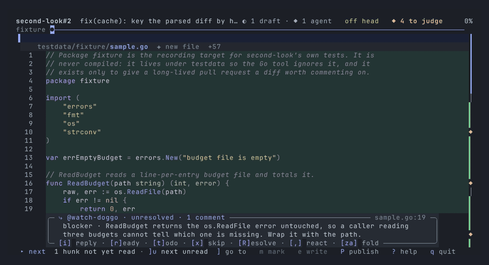
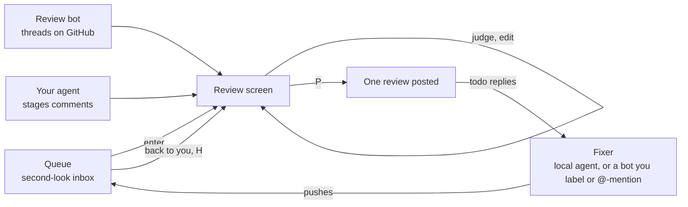
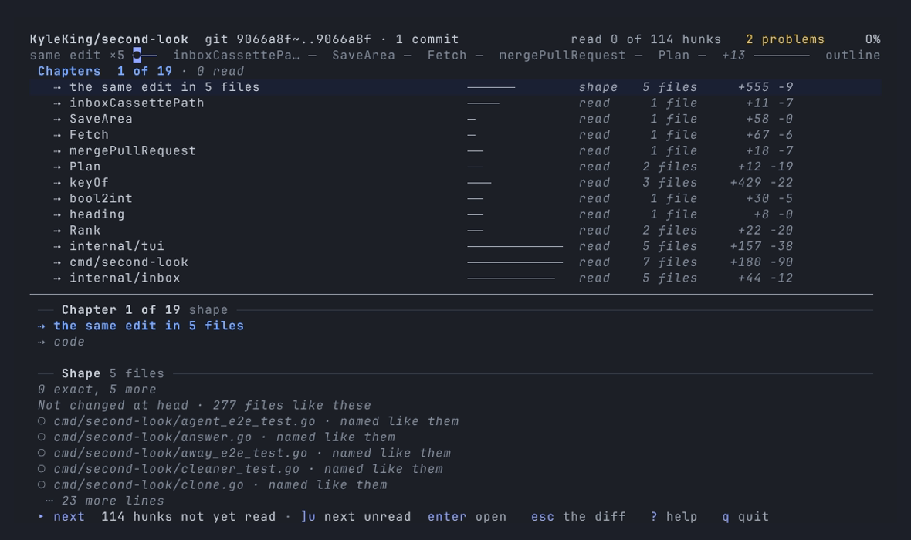
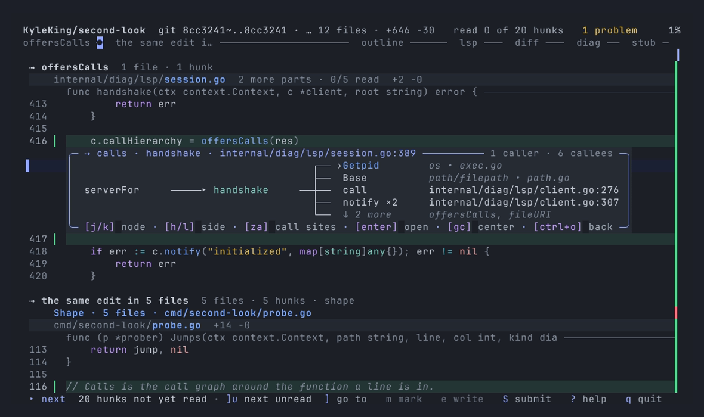
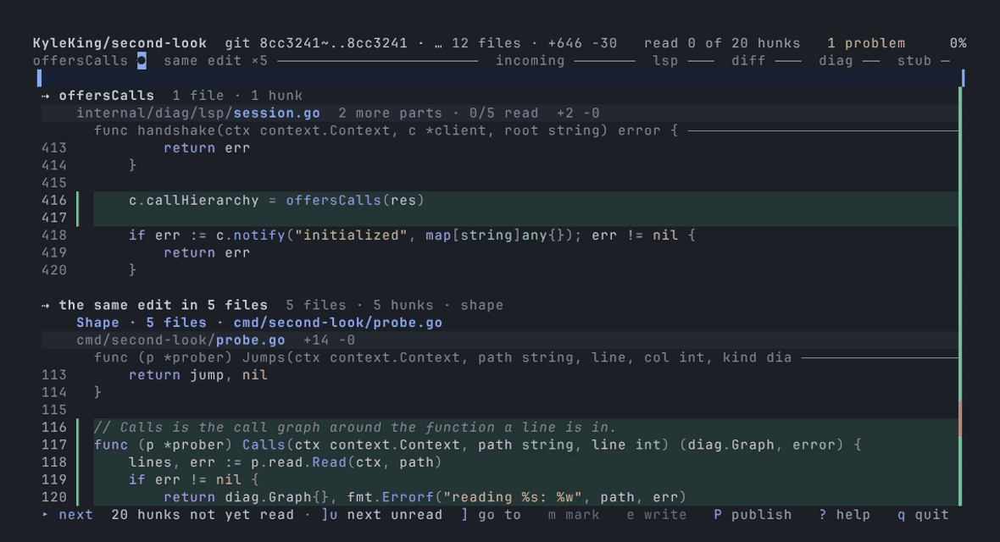

# second-look

A terminal code review tool optimized for the modern rate of code generation, is local-first and AI-friendly, and encourages us to actually read and understand the code as everything else changes. While this is currently personalized for my own use cases and workflows, it should be straightforward to generalize and I'm open to input and making changes because I would be happy to see others find value in this. Feel free to open a GitHub issue and let me know what you think!



## How a review moves



The queue has three tabs, inbox, conversations, and staged, which `1`, `2`, `3`, `]q`, and `[q` switch between. Every row is one line on a shared grid, so titles start in the same column on all three, and the row under the cursor is a single tinted band. A line under the list says what the row had no room for, such as the full title, the commit prefix, and who it is waiting on. `esc` on a review opens the queue again, and `bb` on a review opens its checkout in [gh-repo-dashboard](https://github.com/KyleKing/gh-repo-dashboard) and returns when you quit it.

![The inbox in lanes, \]u to the next row needing a look, za showing the merged lane, then the conversations and staged tabs](docs/images/queue.gif)

The inbox is ordered to keep the amount of work in progress small. Your own pull requests that are approved and ready to merge come first, then anything waiting on a reply from you, then reviews you have already started, then new review requests (priority labels and pull requests where you are the only human reviewer go to the top). Work waiting on somebody else and merged pull requests come last and recede, so the rows that need you are the brightest, and `za` shows the merged lane. Each finding from a review bot or teammate gets one of four verdicts:

| Key | Verdict | What posts |
| --- | ------- | ---------- |
| `r` | discuss | your reply, thread stays open |
| `t` | todo | your reply, and the finding goes to your local agent |
| `R` | won't fix | your reply, then the thread is resolved |
| `x` | skip | nothing |

If you don't write a reply, your agent drafts one that fits the verdict, and you can edit it before anything is posted. A bot that fixes on a label or a mention needs no setting here: `l` labels the pull request from the repository's own labels, and `@` in a reply completes the bots and people seen on its recent pull requests. Once the fixes are pushed, the pull request moves back into your inbox and `H` shows which of the todos the new commits addressed.

`i` on a line asks for the severity (`b` blocker, `m` major, `n` minor, `t` nit, `?` question) and opens the comment in place, where `enter` saves it, `ctrl+j` (or `alt+enter`) starts a new line, and `esc` leaves with what you typed kept for next time. Every text field in second-look, jojo, and jj-diff takes enter to submit, and saving here only stages a draft: nothing is sent until `P`. `P` is the publish page: it names what is still a draft before anything goes, and `Pr` requests changes and asks who gets the todos.


## Reading a big change

Large diffs open on an outline that splits the change into chapters, with how much of each you've read and how many findings are still open. Hunks are grouped by the symbol they change, generated files and lockfiles are folded into a summary, and the language server you already use powers `gd`, `gr`, and `gc` (the callers and callees of a function) against the commit under review.

![Opening a chapter from the outline, marking hunks read with space and \]u, and the read strip moving on the outline](docs/images/read.gif)

<p>


</p>

The keybindings follow vim, so `]c` goes to the next comment, `]u` to the next unread hunk, `za` toggles a fold, and `n` repeats the last motion. The footer shows the keys that apply at the cursor and `?` lists the rest.

`\` changes what is shown, and a second `\` walks the views: the diff, the code at head, and the comments alone. `H` compares against an earlier round of the review and says which todos the commits since answered, and `]r` and `[r` step between rounds.

![H listing the rounds and the todos each answered, \]r stepping rounds, and \\ walking from the diff to the code and the comments](docs/images/views.gif)

## Keys

second-look shares one keymap with [jojo](https://github.com/KyleKing/jojo) and [jj-diff](https://github.com/KyleKing/jj-diff) through [aragonite](https://github.com/KyleKing/aragonite), so a key means one thing in all three: `u` is undo, `space` ticks the item at point (here it marks it read), `v` is a visual range, `Y` yanks, `ctrl+l` reloads, and `g`, `z`, `]`, `[`, `\`, and `b` are prefixes that never act alone. A test fails the build when a key drifts from that table.

| Key | Review screen | Queue |
| --- | ------------- | ----- |
| `i` | comment on the line (then `b` `m` `n` `t` `?` for the severity), or reply on a thread | reply to the conversation, or comment on the pull request |
| `e` | edit what is there: a staged comment, the review's own prose | |
| `P` | publish: `Pa` approve, `Pr` request changes, `Pc` comment, `Pp` post the comment under the cursor; the page opens even when the review cannot post yet, and says why | `Pa` approve, then `Pa` again to confirm |
| `space` | mark the hunk read | mark the row read |
| `]u` / `[u` | next / previous unread hunk | next / previous row needing a look |
| `]q` / `[q` | | next / previous queue (also `1` `2` `3`) |
| `r` `d` `t` `x` | a state on the comment or thread under the cursor: ready, draft, todo, skip (`m` then the letter does the same); `R` resolves a thread | |
| `\` | what is shown: `\t` threads, `\c` comments, `\g` grammar, `\s` side by side, `\w` wrap, `\i` images, `\p` the next preset, `\\` the next view | |
| `v` / `V` | a range of lines | |
| `bb` / `bd` | the checkout's branches and CI / delete the branch | |
| `gi` | the card about the pull request | |
| `Y` | yank `path:line` | yank `owner/repo#number` |
| `ctrl+l` | restage | read the queue again |
| `za` | fold or unfold this | show or hide the folded lane |
| `:clean` | | drop staged reviews whose pull request finished (`:clean stale` too) |
| `esc` | back out one level: a prompt, the legend, a peek, then the queue | clear the filter; at the top it says `q` quits |
| `q` | leave the review | quit |

Keys that moved in 0.60 (`a` comment, `S` submit, `P` post one, `B`, `D`, `i` info, `u` and `v` looks, `t` and `c` toggles, `ctrl+r`, `y`/`Y` scroll, and in the queue `m`, `A`, `r`, `u`/`U`, `]`/`[`, `z`, `gc`) say where they went when pressed, for one release.

A key that can do nothing at the cursor stays in the footer, dimmed, and the legend says why. In the legend, pressing a key explains it rather than running it, `/` filters, and enter runs the row. `:` searches every key and command by what it does and runs it, then names the key for next time. The footer's status slot names the next step while one holds (unread hunks, findings to rule on, a review ready to submit), and after the first minute an occasional tip about a key you have not used, gone at the next key. `coach = "band"` in the config, or `:next`, draws the next steps as a band above the footer instead. Tips remember what they have shown in `$XDG_STATE_HOME/second-look/coach.json`, and `:tips off` stops them.

The queue and the review screen share all of it: the queue's `?` and `:` are the same palette, its keys say why they do nothing on a heading, and its footer points at the next step (a review requested of you, a conversation that moved). The first launch opens on a welcome card of five starter keys and where the rest are; any key closes it and still does what it does (esc only closes it), it never shows again on its own, and `:welcome` brings it back.

Every run also logs its subcommand and the names of the flags it was given, never their values or the pull request, and `second-look keys` reports the subcommands and flags you never use beside the keys.

## Install

```bash
brew install --cask kyleking/tap/second-look
# or
go install github.com/kyleking/second-look/cmd/second-look@latest
```

sl requires [gh](https://cli.github.com), while language servers and
[ast-grep](https://ast-grep.github.io) are optional

## Use

```bash
second-look inbox                    # the queue of pull requests waiting on you
second-look 10                       # review #10 in this repository
second-look kyleking/second-look#10  # or any pull request, no clone needed
second-look local                    # review your own unpushed change before it goes up
```

`second-look local` takes a jj revset with `-r` or a git range with `--range`. Here it reads this repository's own commit 8cc3241, and `gc` asks gopls for the call graph around a function.



A click puts the cursor on a row or switches to a tab, and the wheel moves the cursor. The screen holds the mouse to do that, so hold shift (option in some terminals) to select text.

Agents like Claude Code use second-look through a skill that the binary prints, which you can install with:

```bash
second-look skill > ~/.claude/skills/second-look/SKILL.md
```

Re-run it after upgrading so the skill matches the binary. `second-look --help` covers the remaining commands, and [config.example.toml](config.example.toml) documents the settings you can put in `~/.config/second-look/config.toml`.

## Fonts

File headings and states draw a filetype icon from the Nerd Font symbols in a terminal that bundles
them (WezTerm, kitty 0.33 and later, Ghostty), and glyphs every monospace font has everywhere else,
because those every terminal measures alike. The bottom row of `?` names the set in use and why, such
as `icons  nerd (auto: WezTerm)`. Set `icons = "plain"` in the config, or `ARAGONITE_ICONS=plain`, to
keep the plain glyphs; `"nerd"` forces the icons with a [Nerd Font](https://www.nerdfonts.com/) (a
Mono one) in any terminal, and `"none"` draws no icons. The variable is shared with jj-diff and jojo
and wins over the config. Inside tmux the terminal is read from the variables the tmux server
inherited, so a session attached from a different terminal may need the setting.

## More

- [DESIGN.md](DESIGN.md) covers the problem, the main design decisions, and the architecture
- [ROADMAP.md](ROADMAP.md) lists what I plan to work on next
- [CONTRIBUTING.md](CONTRIBUTING.md) explains how to build and test it

## Inspiration

second-look borrows ideas from a lot of great tools, and I'd recommend checking them out:

- [gh-dash](https://github.com/dlvhdr/gh-dash) for a configurable dashboard of pull requests in the terminal (second-look reads gh-dash style queries for its inbox sections)
- [Hunk](https://github.com/modem-dev/hunk) for a TypeScript review TUI where agents annotate a live review session through a skill
- [prr](https://github.com/danobi/prr) for preparing a review locally as a file and posting it in one request
- [tuicr](https://github.com/agavra/tuicr) for a vim-style review TUI over git, jj, and Mercurial that submits real GitHub reviews
- [diffnav](https://github.com/dlvhdr/diffnav) and [delta](https://github.com/dandavison/delta) for reading diffs in the terminal
- [difftastic](https://github.com/Wilfred/difftastic) for structural, syntax-aware diffs
- [Reviewable](https://reviewable.io) for tracking what you've reviewed across force-pushes
- [lazygit](https://github.com/jesseduffield/lazygit) for showing that a keyboard-driven TUI can be discoverable
