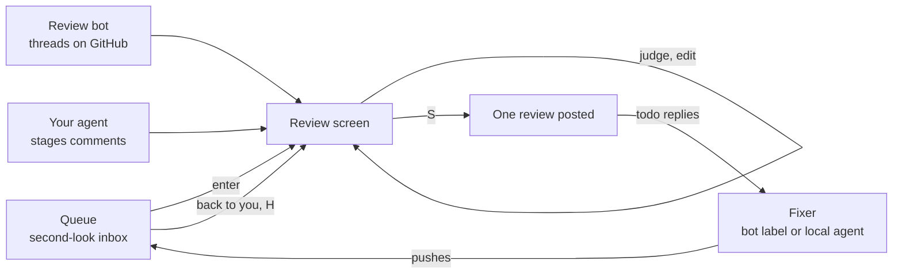

# second-look

A terminal code review tool for pull requests written by agents, bots, and people you
haven't worked with long. It exists because I stopped reading the code we ship. A
review bot finds things, an agent drafts replies, and none of it means much if nobody
reads the diff and thinks about it.

second-look puts the diff, the open threads, and your staged comments on one screen.
You judge each finding with a key, hand the fixes to an agent, and post the review in
one call. Nothing reaches GitHub until you press `S`.


## How a review moves



The queue orders pull requests to keep work in flight small: yours that are ready to
merge, then anything back in your court, then new requests, with priority labels and
"you are the only human asked" first. A finding gets one of four verdicts:

| Key | Verdict | What posts |
| --- | ------- | ---------- |
| `r` | discuss | your reply, thread stays open |
| `t` | todo | your reply, and the finding goes to a fixer |
| `R` | won't fix | your reply, then the thread is resolved |
| `x` | skip | nothing |

Leave the reply blank and the agent drafts one for that verdict. When the fixer pushes,
the pull request comes back to you and `H` shows which todos the new commits answered.

## Reading a big change

Large diffs open on an outline of chapters, each with its read progress and how many
findings are left to judge. Hunks are grouped by the symbol they change, generated files
and lockfiles fold to a summary, and the language server you already use answers `gd`,
`gr`, and `gc` (the call graph around a function) against the commit under review.


<p>


</p>

The keys follow vim: `]` and `[` with an object move (`]c` comment, `]u` unread hunk,
`]f` file), `z` folds, `g` jumps, and `n` repeats. The footer shows what works where the
cursor is, and `?` lists everything.

## Install

```bash
brew install --cask kyleking/tap/second-look
# or
go install github.com/kyleking/second-look/cmd/second-look@latest
```

It needs [gh](https://cli.github.com), signed in. A language server and
[ast-grep](https://ast-grep.github.io) are optional and add checks and navigation.

## Use

```bash
second-look inbox          # the queue of pull requests waiting on you
second-look 42             # review #42 in this repository
second-look owner/repo#42  # or any pull request, no clone needed
second-look local          # review your own unpushed change before it goes up
```

Agents draft comments through a skill the binary prints. Install it once, and again
after an upgrade:

```bash
second-look skill > ~/.claude/skills/second-look/SKILL.md
```

`second-look --help` covers the rest of the commands. Settings live in
`~/.config/second-look/config.toml`, and [config.example.toml](config.example.toml)
shows every key with what it does.

## More

- [DESIGN.md](DESIGN.md) explains the problem, the decisions behind the screen, and how
  the pieces fit
- [ROADMAP.md](ROADMAP.md) lists what is next
- [CONTRIBUTING.md](CONTRIBUTING.md) covers building and testing
